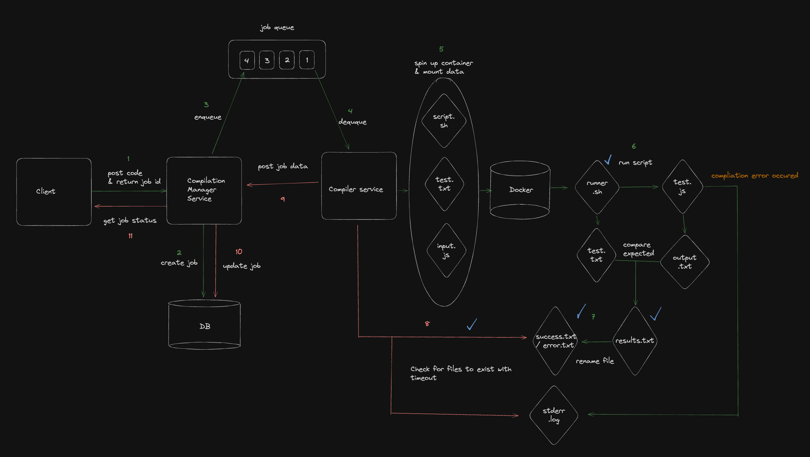

# AlgoRace

A multiplayer data structures and algorithms practice platform. Solve problems solo, or race
friends in a shared lobby — with a custom, containerised remote compiler that executes
untrusted user-submitted code safely.

Built in 2023 as a capstone project. **This is an archive**: the services are no longer deployed
and the original Heroku/EC2/Vercel hosting is gone. The code and architecture are preserved here
as a single repository, consolidated from the seven repos it was originally split across.



## Why it's interesting

The hard problem in AlgoRace isn't the UI, it's **running arbitrary code from strangers without
letting it hurt you**. The answer was a detached worker pool: submissions are queued, picked up by
a worker with operating-system-level access, and executed inside a throwaway Docker container whose
stdout is diffed against expected output. Nothing the user submits ever runs in a service process.

The second decision worth noting is that the **manager and worker never talk directly** — only
through the queue. That was deliberate, so worker capacity could be scaled horizontally under load
without the manager knowing or caring how many workers exist.

## Layout

```
web/                        React client — Monaco editor, socket.io, lobby and race UI
services/
  user-service/             Auth (JWT), problems, lobby CRUD
  socket-server/            Socket.IO server — lobby membership and live race state
  compile-manager/          Accepts submissions, creates jobs, enqueues to RabbitMQ
  remote-compiler/          Worker — Docker sandbox, runs code, reports results back
  compile-api-go/           Incomplete Go rewrite of compile-manager
assets/                     Architecture diagram
```

Each directory keeps its own README with service-level detail and endpoints.

## How a submission flows

1. The client POSTs code and a problem id to **compile-manager**.
2. The manager creates a `CompileJob` with status `pending`, puts it on the **RabbitMQ** queue, and
   immediately returns a `jobId` — the request does not block on compilation.
3. The client polls `GET /job-status/:jobId`.
4. **remote-compiler**, subscribed to the queue, assembles the submitted code and a `test.txt` of
   expected outputs, mounts both into a fresh Docker container alongside a `runner.sh`, and runs it.
5. `runner.sh` executes the code and diffs stdout against the expected outputs, writing
   `success.txt` or `errors.txt`.
6. The worker PATCHes the manager with the result and the captured stdout/stderr.
7. The client's next poll returns `success` or `failed` with the output.

Multiplayer runs on a separate path: **socket-server** holds lobby membership and race state over
Socket.IO, so readiness and progress propagate without polling.

## Stack

Node, React, MongoDB, RabbitMQ, Docker, Socket.IO, Bash. Originally the API services ran on Heroku,
the worker on an AWS EC2 instance (it needed OS-level Docker access), and the client on Vercel.

Data lives in MongoDB across two collections: `problems` as a master list of titles, difficulties
and types, and problem code keyed uniquely by title *and* language together, so the same problem can
carry different starter code and test harnesses per language.

Auth is JWT, stored client-side in cookies.

## What was never finished

- **`compile-api-go`** was a Go rewrite of the compile manager. Routing and Mongo are wired up and
  `POST /jobs` works; the read, update and delete handlers are empty stubs, and its model describes
  a problem rather than a job. The Node manager is the version that actually ran.
- Language support reached a handful of languages against a small problem set.
- The planned public remote-compilation API was never built.

## Running it

There's no single compose file — each service was deployed independently and expects its own
environment (Mongo URI, RabbitMQ URL, JWT secret, and the sibling service URLs). The worker needs a
working Docker daemon and will spawn containers on the host it runs on.

Service URLs the client expects are in `web/src/config/constants.js`.
